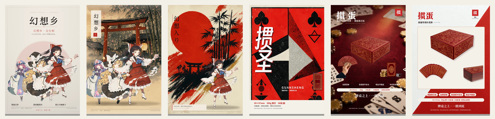
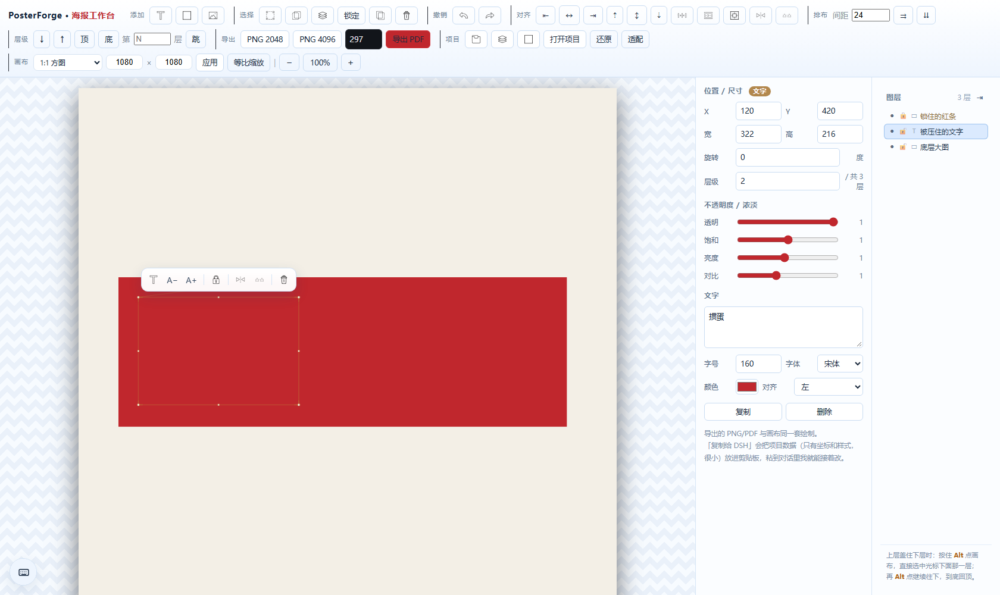

<div align="center">

# Poster8G · 8G 海报

**The poster workshop that runs on your own 8 GB GPU.**

Local AI backgrounds · cut-out assembly · QR verification · editable workbench · print-ready output

[中文](README.zh.md) · [Install](docs/INSTALL.md) · [Manual](docs/MANUAL.md) · [CHANGELOG](CHANGELOG.md)

</div>



Six posters, one pipeline. The three on the left are 東方Project fan pieces (generated, cut out, laid out,
exported to print). The three on the right are one playing-card product launch, rendered as three different
treatments: a screen-print art version, a felt-table scene, and a clean white e-commerce layout. The red-lacquer
gift box was shot on white, cut to a transparent PNG and composed over an AI-generated background, with the spec
strip, the selling points and the compliance line all placed as *editable layers* — not baked into the picture.

---

## Who this is for

You are comfortable opening a design tool, but you do not want to learn a design suite.
You want AI backgrounds, but you do **not** want to pay per image, and you do **not** want your client's
product photos uploaded to somebody's cloud. Your GPU is a normal one — **8 GB of VRAM**, the card that came
with the machine.

That is exactly the machine this was built on and tuned for. Every default in here assumes 8 GB: int8 weights,
`--lowvram`, 1024-class generations, one job at a time. Of the two local engines we wired up, **FLUX is the one
we reach for** — best texture and lighting per second on a small card. MOSS-Image is there when you need a
model that reads Chinese prompts more literally, or when you want the whole layout generated in one shot.

What you get out the other end is not a picture. It is a **print-ready PDF**, plus a project file you can
re-open and edit next Tuesday.

## What it actually does

| | |
|---|---|
| **Local generation** | ComfyUI on `localhost`, FLUX 3 Klein / MOSS-Image. Text-to-image, multi-reference, inpainting-style edits. No API key, no per-image bill, no upload. |
| **Cut-out assembly** | GrabCut on white/light backgrounds → transparent PNG with feathered edges and no white fringe. Paste onto any background losslessly, with a real drop shadow. |
| **Editable workbench** | One self-contained HTML file, opens offline with a double-click. Drag, scale, rotate, crop, group, lock, flip, align, distribute, opacity, 8 font families, export PNG 2048 / 4096 / PDF. |
| **QR that survives print** | Generate, recolor, batch; then **decode every code in the file** before you send it to the printer. A code smaller than 11.5% of the canvas short edge is rejected — that is the size where phone cameras start failing on paper. |
| **Composition by job file** | A `job.json` describes canvas, patches, pastes, slots; one command renders the print file and runs pre-flight (overlap, bleed, QR size, font size). |
| **Find anything under anything** | The layer panel on the right lists every element by name; or hold **Alt and click** on the canvas to click *through* the top layer and select what is underneath. Locked layers pass clicks through instead of swallowing them. |



## Install

```bash
# 1. the plugin
dsh plugin add dsh-8g-poster        # or: npm i -g dsh-8g-poster

# 2. python side (Pillow, numpy, opencv, reportlab, qrcode, zxing-cpp)
python -m pip install -r skill/requirements.txt

# 3. a local ComfyUI on port 8189 with the models below
```

Full walkthrough, including **both model downloads** (~10 GB total), ComfyUI flags for 8 GB cards, and how to
verify the install: **[docs/INSTALL.md](docs/INSTALL.md)**.

### Models

| Engine | Files | ~Size | Where |
|---|---|---|---|
| **FLUX 3 Klein** (recommended) | `flux-2-klein-4b.safetensors`, `qwen_3_4b.safetensors` (or an int8 build), `flux2-vae.safetensors` | 10.3 GB | [Comfy-Org/Flux-2-Klein-4B](https://hf-mirror.com/Comfy-Org/Flux-2-Klein-4B) |
| **MOSS-Image** (optional) | `moss_image_sft_int8_convrot`, `qwen3.5_9b_w4a8_gptq`, `flux2-vae`, 2 LoRAs | 12.8 GB | [Comfy-Org/MOSS-Image](https://hf-mirror.com/Comfy-Org/MOSS-Image) |

The plugin expects the *community int8* file names by default. If you download the official names, either
rename the files or point the plugin at them with `POSTER_UNET` / `POSTER_CLIP` / `POSTER_VAE` — no code edit.

## The 13 tools

`poster_guide` `poster_workspace` `poster_generate` `poster_editor` `poster_open` `poster_fonts`
`poster_templates` `poster_cutout` `poster_detect_slots` `poster_compose` `poster_check` `poster_versions` `poster_qr`

Two entry points, one implementation: a DSH plugin (`lib/index.js`) and an MCP stdio server
(`server/index.js`), both on top of `lib/core.js`. Tool reference: **[docs/MANUAL.md](docs/MANUAL.md)**.

## A typical session

```
you:  用8G 海报做一张掼蛋扑克牌的海报，产品图我已经抠好了
agent: poster_guide → poster_workspace(status) → 问路线
you:  flux
agent: poster_generate ×3  →  三版无字背景
agent: 排字 → 贴抠好的产品 PNG → poster_check
agent: 把三版发你看看，选一版
you:  第三版，艺术版那个
agent: poster_editor → 工作台项目 JSON → 你双击打开继续改
you:  …改完导出 PDF
```

## Requirements

- Node ≥ 18
- Python ≥ 3.8 with `Pillow numpy opencv-python-headless reportlab qrcode zxing-cpp`
- ComfyUI reachable at `http://127.0.0.1:8189` (configurable via `POSTER_COMFY`)
- 8 GB VRAM is enough; 12 GB+ gives you headroom for 1536-class generations

## Honest limits

- **AI cannot draw Chinese text.** Every model we tried turns 「掼蛋」into plausible-looking nonsense. The
  pipeline is built around this: generate backgrounds *without* text, keep a blank gold label plate where text
  belongs, then set real text in the workbench. Anyone selling you "AI generates the whole poster with text" is
  selling you retouching work.
- The workbench is a layout tool, not Illustrator. No bezier paths, no CMYK conversion. Files export as RGB
  PDF; ask your printer whether they want RGB or a converted CMYK file.
- Prices and claims in any generated copy are your responsibility. The sample posters ship with a compliance
  line for exactly this reason.

## License

MIT for the code. Bundled 得意黑 (Smiley Sans) is under SIL OFL 1.1 — see `assets/fonts/LICENSE.md`.
System fonts referenced by the workbench are not redistributed.
