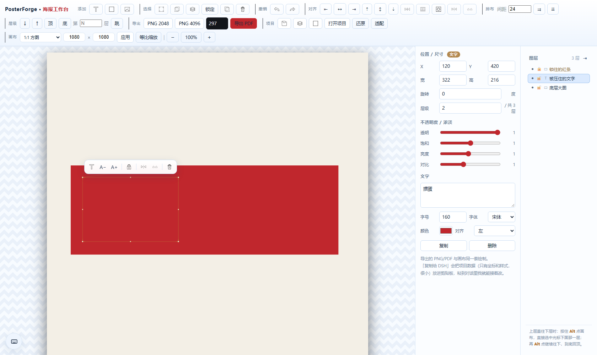

<div align="center">

# 海报匠 · Posterwright

**8GB 显存，也能开一间自己的海报印刷厂。**

本地 AI 出背景 · 抠图合成 · 二维码防错校验 · 可编辑工作台 · 直接出印刷件

[English](README.md) · [安装](docs/INSTALL.zh.md) · [使用手册](docs/MANUAL.zh.md) · [更新日志](CHANGELOG.md)

</div>


五张海报，一条流水线。左边三张是東方Project 同人（AI 生成 → 抠图 → 排版 → 导出印刷件）；
右边两张是扑克牌产品上市：深红漆面礼盒白底实拍 → 抠成透明 PNG → 压在 AI 生成的背景上，
参数条、卖点、合规小字**全是可编辑图层**，不是糊死在图里的像素。

---

## 这是给谁用的

你多少会点设计，但不想为此去学一整套设计软件。
你希望海报里的背景、氛围由 AI 来给，但**不想按张付费**，也**不想把客户的产品图传到别人的云上**。
你的显卡就是张普通卡——**8GB 显存**，买机器时带的那张。

这个插件就是在这样的机器上写出来、并且只按这个机器调过的。所以它的每个默认值都假设 8GB：
int8 权重、`--lowvram`、1024 级出图、一次只跑一个任务。两个本地引擎里，**我们平时最顺手的还是 FLUX**
——小卡上它的质感与光影性价比最高；MOSS-Image 留着在你需要模型老老实实读中文提示词、
或者想一次性生成整版构图的时候用。

最后交到你手上的不是一张图片，是一份**印刷用的 PDF**，外加一个下周二还能打开继续改的项目文件。

## 它到底能干什么

| | |
|---|---|
| **本机出图** | 接 `localhost` 上的 ComfyUI：FLUX 3 Klein / MOSS-Image。文生图、多图融合、局部改图。没有 API Key、没有按张计费、素材不出本机。 |
| **抠图合成** | 白底/浅底走 GrabCut → 透明 PNG，边缘羽化且不留白边；贴到任何背景上都无损，还能加真实投影。 |
| **可编辑工作台** | 一个自带全部依赖的 HTML 文件，双击离线打开。拖拽、缩放、旋转、裁剪、组合、锁定、翻转、对齐分布、透明度、8 套字体，导出 PNG 2048 / 4096 / PDF。 |
| **印得出来的二维码** | 生成、换色、批量，然后在发印厂之前**把整张图里的码逐个解码**。小于画布短边 11.5% 的码直接判死——那正是纸面上手机开始扫不出来的尺寸。 |
| **按 job.json 合成** | 一个 JSON 描述画布、覆盖重绘、贴素材、占位块，一条命令出印刷件，并顺带做印前自检（遮挡、出血、码尺寸、最小字号）。 |
| **再深的东西也能点到** | 右侧图层面板按名字列全部元素；或者在画布上**按住 Alt 单击**，穿过上层直接选到下面那层。锁定的图层不再吞点击，而是让下去。 |



## 安装

```bash
# 1. 装插件
dsh plugin add dsh-posterwright        # 或 npm i -g dsh-posterwright

# 2. python 侧依赖（Pillow、numpy、opencv、reportlab、qrcode、zxing-cpp）
python -m pip install -r skill/requirements.txt

# 3. 本机 ComfyUI 跑在 8189 端口，并下好下面两个模型
```

完整步骤（含**两个模型的下载命令**、8GB 显卡的 ComfyUI 启动参数、装完怎么验证）：
**[docs/INSTALL.zh.md](docs/INSTALL.zh.md)**。

### 模型

| 引擎 | 文件 | 约大小 | 下载 |
|---|---|---|---|
| **FLUX 3 Klein**（推荐） | `flux-2-klein-4b.safetensors`、`qwen_3_4b.safetensors`（或 int8 版）、`flux2-vae.safetensors` | 10.3 GB | [Comfy-Org/Flux-2-Klein-4B](https://hf-mirror.com/Comfy-Org/Flux-2-Klein-4B) |
| **MOSS-Image**（可选） | `moss_image_sft_int8_convrot`、`qwen3.5_9b_w4a8_gptq`、`flux2-vae`、2 个 LoRA | 12.8 GB | [Comfy-Org/MOSS-Image](https://hf-mirror.com/Comfy-Org/MOSS-Image) |

插件默认读的是**社区 int8 文件名**。你要是下的官方文件名，二选一：把文件改名，或者用
`POSTER_UNET` / `POSTER_CLIP` / `POSTER_VAE` 指过去——不用改代码。

## 13 个工具

`poster_guide` `poster_workspace` `poster_generate` `poster_editor` `poster_open` `poster_fonts`
`poster_templates` `poster_cutout` `poster_detect_slots` `poster_compose` `poster_check` `poster_versions` `poster_qr`

两个入口，一份实现：DSH 插件（`lib/index.js`）与 MCP stdio 服务器（`server/index.js`），底下共用
`lib/core.js`。工具详解见 **[docs/MANUAL.zh.md](docs/MANUAL.zh.md)**。

## 一次完整对话长什么样

```
你：  用海报匠做一张掼蛋扑克牌的海报，产品图我已经抠好了
AI：  poster_guide → poster_workspace(status) → 问走哪条路线
你：  flux
AI：  poster_generate ×3  →  三版无字背景
AI：  排字 → 贴抠好的产品 PNG → poster_check 自检
AI：  三版发你看，选一版
你：  第三版，艺术版那个
AI：  poster_editor → 工作台项目 JSON → 你双击打开继续改
你：  …改完导出 PDF
```

## 环境要求

- Node ≥ 18
- Python ≥ 3.8，且有 `Pillow numpy opencv-python-headless reportlab qrcode zxing-cpp`
- ComfyUI 默认在 `http://127.0.0.1:8189`（可用 `POSTER_COMFY` 改）
- 8GB 显存够用；12GB 以上能把出图尺寸开到 1536 级

## 说清楚的边界

- **AI 画不出中文。** 我们试过的模型都会把「掼蛋」画成似是而非的鬼画符。整条流水线就是围着这件事设计的：
  背景**不带字**地生成，该有字的地方留一块空白铭牌，真正的文字在工作台里排。谁跟你说"AI 能连字一起生成整张海报"，
  卖给你的其实是修图工时。
- 工作台是排版工具，不是 Illustrator。没有贝塞尔路径，也不做 CMYK 转色。导出的是 RGB PDF，
  印厂要 CMYK 的话请他们转，或先问清楚制版要求。
- 生成文案里的价格、资质、功效表述由你负责。示例海报底下那行合规小字就是为这件事留的位置。

## 授权

代码 MIT。随包的得意黑（Smiley Sans）是 SIL OFL 1.1，见 `assets/fonts/LICENSE.md`。
工作台里引用的系统字体不做分发。
